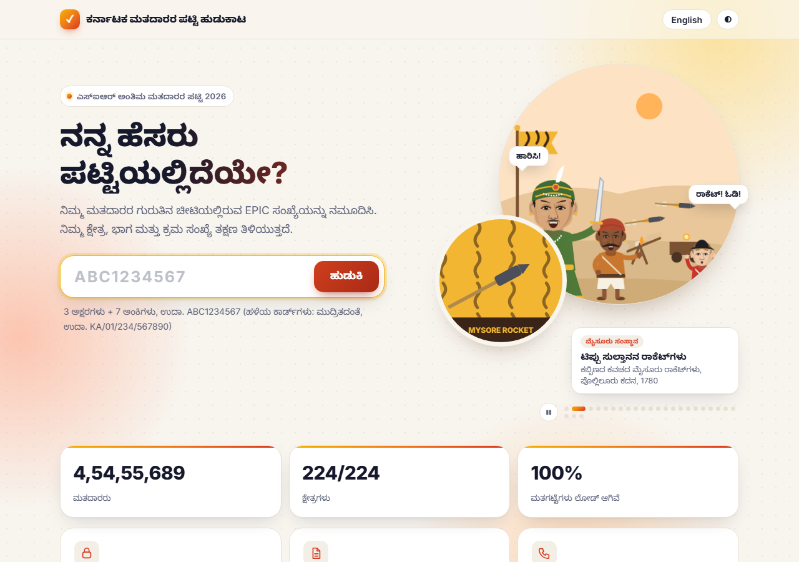
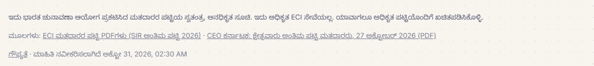
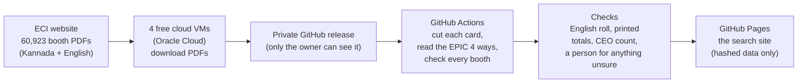

# Karnataka Final Roll 2026 — EPIC search

Type the EPIC number from your voter ID card and the site tells you your
constituency (AC), polling booth (part) and serial number on Karnataka's
**SIR final electoral roll 2026**, with a link to the official ECI PDF of
that booth. If the roll strikes your entry off with a DELETED stamp, the site
says so and where. It is unofficial: it only re-arranges data ECI has
published.

**Site:** https://gouthamganeshm.github.io/Karnataka_Final_Roll_2026/

## Status (31 Oct 2026)

| | |
|---|---|
| Roll | SIR final roll, published by ECI on 27 Oct 2026 (`S10-2026-SIR-FIR-1`) |
| Coverage | all **224 constituencies**, all **60,923 booths** |
| Electors on the site | **4,54,55,689** — exactly the CEO Karnataka's official count |
| Constituencies matching the official count | **224 of 224**, to the last voter ([proof table](docs/proof/official-match.md)) |
| Deleted entries (searchable, not counted) | 1,88,331 |
| Every card cross-checked against the English roll | yes ([how](docs/english-crosscheck-runbook.md)) |
| Next step | a 25% sample check of every booth, PDF to live site ([plan](docs/sample-verification.md)) |

The two sources the site is built from and checked against are linked at the
bottom of every page:

* **ECI electoral roll PDFs** — https://voters.eci.gov.in/download-eroll (one
  PDF per booth, in Kannada and in English)
* **CEO Karnataka AC-wise final-roll booklet** —
  https://ceo.karnataka.gov.in/uploads/PDF%20FINAL%20AC%20WISE%2027_1793094730.pdf
  (official elector count per constituency)

## How it works, in one picture

1. **Download.** ECI's servers refuse GitHub's own machines, so four free
   Oracle Cloud VMs download the booth PDFs. [How the VMs are set up and
   run](docs/vm-process.md).
2. **Read.** Each PDF page is a picture of 30 voter cards (10 rows × 3). The
   cards are cut out and the EPIC on each is read by four different readers.
   A character is accepted only when independent readers agree.
3. **Check.** Every booth's cards are checked against the totals printed in
   the PDF itself, against the separately typeset English roll, and every
   constituency against the CEO's official count. Anything the machines
   could not settle was looked at by a person. Details:
   [accuracy and proof](docs/accuracy-and-proof.md).
4. **Publish.** Only hashed fragments of EPICs are published. The site has no
   server: the search happens inside the visitor's browser.

## Documentation

| Document | What it explains |
|---|---|
| [docs/accuracy-and-proof.md](docs/accuracy-and-proof.md) | Every check the data went through, with numbers |
| [docs/proof/official-match.md](docs/proof/official-match.md) | All 224 constituencies: site count vs the CEO booklet |
| [docs/vm-process.md](docs/vm-process.md) | The four cloud VMs: why, how they were made, what runs on them, cost |
| [docs/english-crosscheck-runbook.md](docs/english-crosscheck-runbook.md) | The full English-roll cross-check and manual review |
| [docs/sample-verification.md](docs/sample-verification.md) | The 25%-of-every-booth check from PDF to live site |
| [docs/site-voter-details.md](docs/site-voter-details.md) | Planned: age, gender, relation and polling station on the search result |
| [docs/dataset.md](docs/dataset.md) | The planned open dataset: age, gender, relation per entry, no names, EPIC only as a keyed hash |
| [PLAN.md](PLAN.md) | The original design (written before the roll came out) |

## What the final roll looks like (and how it is read)

* **Deleted electors stay in the PDF.** Their card keeps its serial, gets a
  diagonal DELETED stamp and a reason code left of the serial (E dead, S
  shifted, R repeated, M missing, Q disqualified). `#` in the same place means
  *modified*, still on the roll. The site says "Marked DELETED in the final
  roll" with AC, part, serial and the PDF. Deleted cards are never counted as
  electors.
* **Additions list.** Electors added after the draft come after the main
  list, continuing the serial run.
* **Printed totals.** The cover and the last page print each booth's totals;
  a booth goes live only when the cards read add up to them.
* **EPIC formats.** Most cards are 3 letters + 7 digits (`ABC1234567`). Some
  series have 8 digits, old cards carry the state format with slashes
  (`KA/01/234/567890`), and a handful are printed irregularly; those are kept
  exactly as printed, after a person read them off both rolls.

## Privacy

There is no server and no database. Search happens in the browser:
`SHA-256(EPIC)` bytes 0–1 choose one of 65,536 files `data/roll/<ab>/<cd>.bin`
(each shared by ~27 lakh possible EPICs), bytes 2–5 are looked up inside it.
The EPIC is never sent anywhere or put in the URL. No cookies, analytics or
logs; the browser keeps only the language, theme and scenes seen. Fonts are
self-hosted, so the page requests nothing from any third party; GitHub, as the
host, sees visitors' IPs.

Records are 9 bytes (`scripts/ci/build.mjs`): hash suffix, AC, part (top bit:
deleted), serial (top bit: serial not fully confirmed). The whole state is
~400 MB, inside GitHub Pages' 1 GB limit.

Everything that holds real EPICs (card crops, OCR rows, review decisions)
lives only on **draft** GitHub releases, which only the repo owner can see —
never in git, never in Actions artifacts (those are downloadable by anyone on
a public repo).

## Layout

| Path | What it is |
|---|---|
| `roll-source.json` | The one place the roll's URL, label and release tag are set |
| `reference/ceo-final-2026.json` | Official elector count per AC, from the CEO booklet |
| `reference/vm-plan.json` | Which VM downloads which constituencies |
| `scripts/home/` | Run on the VMs (or a PC): download, dispatch, cross-check, review, apply |
| `scripts/ocr/` | Cutting cards out of pages, the EPIC readers, deletion marks, printed totals |
| `scripts/ci/` | Run on GitHub Actions: OCR per AC, verifier, site build |
| `scripts/release.py` | Private draft-release helper (refuses to touch a published release) |
| `.github/workflows/` | `ocr.yml`, `verify.yml`, `publish.yml`, `series.yml`, `draft-keys.yml` |
| `site/` | The search page (Kannada and English, light and dark) |
| `docs/` | Documentation, proof tables, screenshots |

## Running it yourself

Python 3.10+ with `pip install -r scripts/ocr/requirements.txt`, Tesseract,
and the `gh` CLI logged in; Node 20+ only to build the site locally. The cloud
setup is in [docs/vm-process.md](docs/vm-process.md). The site rebuilds with

    gh workflow run publish.yml -f tag=crops-S10-2026-FR

Successor to [Karnataka_Draft_Roll_2026](https://github.com/gouthamganeshm/Karnataka_Draft_Roll_2026).
