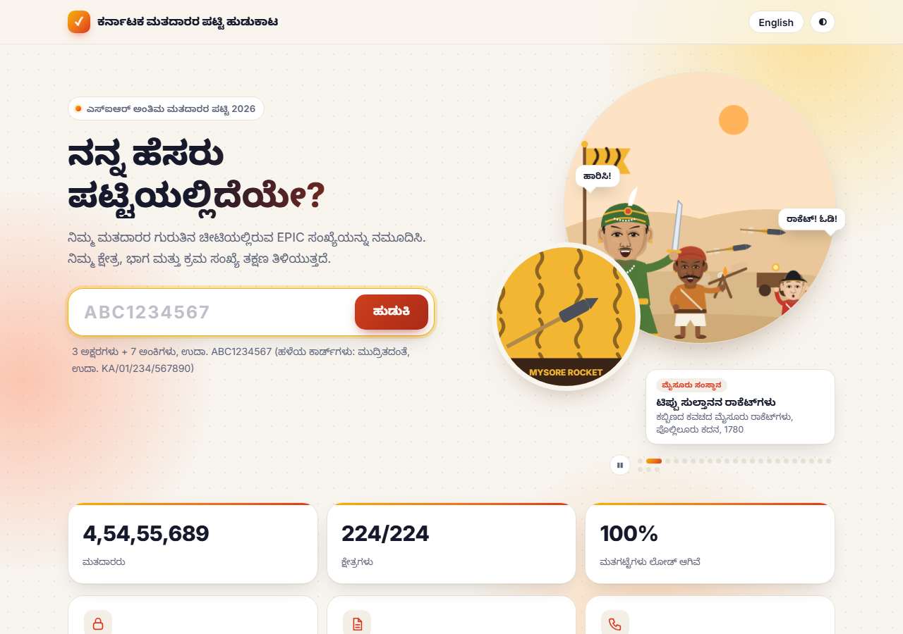
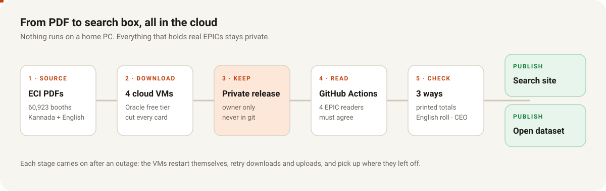
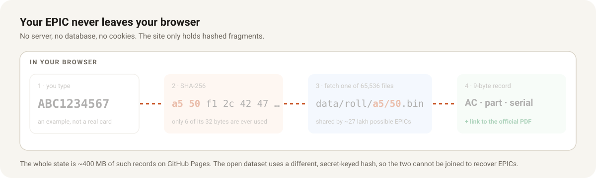

# Karnataka Final Roll 2026

  

  <a href="https://gouthamganeshm.github.io/Karnataka_Final_Roll_2026/"><b>Search your EPIC</b></a> ·
  <a href="https://github.com/gouthamganeshm/Karnataka_Final_Roll_2026/releases/tag/dataset-final-roll-2026-v1"><b>Download the open dataset</b></a> ·
  <a href="docs/accuracy-and-proof.md"><b>How it is checked</b></a> ·
  <a href="docs/proof/official-match.md"><b>Proof: 224 / 224</b></a>

Type the EPIC number from your voter ID card and the site tells you your
**constituency (AC), polling booth (part) and serial number** on Karnataka's
SIR final electoral roll 2026, with a link to the official ECI PDF of that
booth. If the roll strikes your entry off with a DELETED stamp, the site says
so and where.

> **Unofficial.** The site only re-arranges data the Election Commission of
> India has published. Always confirm with the official PDF it links to.

## At a glance (2 Nov 2026)

| | |
|---|---|
| Roll | SIR final roll, published by ECI on 27 Oct 2026 (`S10-2026-SIR-FIR-1`) |
| Coverage | all **224 constituencies**, all **60,923 booths** |
| Electors on the site | **4,54,55,689** — exactly the CEO Karnataka's official count |
| Constituencies matching the official count | **224 of 224**, to the last voter ([proof table](docs/proof/official-match.md)) |
| Deleted entries (searchable, not counted) | 1,88,331 |
| Every card cross-checked against the English roll | yes ([how](docs/english-crosscheck-runbook.md)) |
| 25% sample check, PDF to live site | done for all 60,923 booths: 1,22,97,124 cards; 67 wrong serials found and corrected ([results](docs/proof/sample-verification.md)) |
| Open dataset (age, gender, relation per entry; no names, no EPICs) | all 224 constituencies read; checked against the CEO booklet, a second reading and this site, then published as the release [`dataset-final-roll-2026-v1`](https://github.com/gouthamganeshm/Karnataka_Final_Roll_2026/releases/tag/dataset-final-roll-2026-v1) ([how](docs/dataset.md)) |

Sources, linked at the bottom of every page of the site:
[ECI electoral roll PDFs](https://voters.eci.gov.in/download-eroll) (one PDF
per booth, Kannada and English) and the
[CEO Karnataka AC-wise final-roll booklet](https://ceo.karnataka.gov.in/uploads/PDF%20FINAL%20AC%20WISE%2027_1793094730.pdf)
(official elector count per constituency).

## How it works

1. **Download.** ECI's servers refuse GitHub's own machines, so four free
   Oracle Cloud VMs download the booth PDFs ([how](docs/vm-process.md)).
2. **Read.** Each PDF page is a picture of 30 voter cards. The cards are cut
   out and the EPIC on each is read by four different readers; a character
   is accepted only when independent readers agree.
3. **Check.** Every booth against the totals printed in its own PDF, every
   card against the separately typeset English roll, every constituency
   against the CEO's official count. Anything the machines could not settle
   was looked at by a person ([accuracy and proof](docs/accuracy-and-proof.md)).
4. **Publish.** Only hashed fragments of EPICs go on the site, and it has no
   server: the search happens inside your browser.

## Privacy by design

There is no server and no database. Search happens in the browser:
`SHA-256(EPIC)` bytes 0–1 choose one of 65,536 files `data/roll/<ab>/<cd>.bin`
(each shared by ~27 lakh possible EPICs), bytes 2–5 are looked up inside it.
The EPIC is never sent anywhere or put in the URL. No cookies, analytics or
logs; the browser keeps only the language, theme and scenes seen. Fonts are
self-hosted, so the page requests nothing from any third party; GitHub, as the
host, sees visitors' IPs.

Records are 9 bytes (`scripts/ci/build.mjs`): hash suffix, AC, part (top bit:
deleted), serial (top bit: serial not fully confirmed). The whole state is
~400 MB, inside GitHub Pages' 1 GB limit.

Everything that holds real EPICs (card crops, OCR rows, review decisions)
lives only on **draft** GitHub releases, which only the repo owner can see —
never in git, never in Actions artifacts (those are downloadable by anyone on
a public repo).

## Open dataset

One row for every entry on the roll, with age, gender and relation label as
printed in the English roll, **without names, EPIC numbers or house numbers**.
CSV per constituency, one Parquet file for the state, summaries per booth and
constituency, under the [ODbL 1.0](https://opendatacommons.org/licenses/odbl/1-0/).
Before release it is checked against the CEO booklet, row by row against
this site, and every column is scanned so nothing identifying can slip in.

* Download: [`dataset-final-roll-2026-v1`](https://github.com/gouthamganeshm/Karnataka_Final_Roll_2026/releases/tag/dataset-final-roll-2026-v1)
* Column guide and checks: [docs/dataset-release.md](docs/dataset-release.md)
* How it is made: [docs/dataset.md](docs/dataset.md)

## Documentation

| Document | What it explains |
|---|---|
| [Accuracy and proof](docs/accuracy-and-proof.md) | Every check the data went through, with numbers |
| [Official match](docs/proof/official-match.md) | All 224 constituencies: site count vs the CEO booklet |
| [Cloud VMs](docs/vm-process.md) | The four free VMs: why, how they were made, what runs on them, cost |
| [English cross-check](docs/english-crosscheck-runbook.md) | The full English-roll cross-check and manual review |
| [25% sample check](docs/sample-verification.md) · [results](docs/proof/sample-verification.md) | A quarter of every booth, from PDF to live site |
| [Open dataset](docs/dataset.md) · [release README](docs/dataset-release.md) | How the dataset is made and checked; its column guide |
| [Voter details on the site](docs/site-voter-details.md) | Planned: age, gender, relation and polling station on the search result |
| [Original plan](PLAN.md) | The design, written before the roll came out |

<b>What the final roll looks like, and how it is read</b>

* **Deleted electors stay in the PDF.** Their card keeps its serial, gets a
  diagonal DELETED stamp and a reason code left of the serial (E dead, S
  shifted, R repeated, M missing, Q disqualified). `#` in the same place means
  *modified*, still on the roll. The site says "Marked DELETED in the final
  roll" with AC, part, serial and the PDF. Deleted cards are never counted as
  electors.
* **Additions list.** Electors added after the draft come after the main
  list, continuing the serial run.
* **Printed totals.** The cover and the last page print each booth's totals;
  a booth goes live only when the cards read add up to them.
* **EPIC formats.** Most cards are 3 letters + 7 digits (`ABC1234567`). Some
  series have 8 digits, old cards carry the state format with slashes
  (`KA/01/234/567890`), and a handful are printed irregularly; those are kept
  exactly as printed, after a person read them off both rolls. A card that
  prints a letter for a digit of its EPIC (S for 5) is found under both
  spellings (`aka`, set by a person with `scripts/home/set_aka.py`).

<b>Repository layout</b>

| Path | What it is |
|---|---|
| `roll-source.json` | The one place the roll's URL, label and release tag are set |
| `reference/ceo-final-2026.json` | Official elector count per AC, from the CEO booklet |
| `reference/vm-plan.json` | Which VM downloads which constituencies |
| `scripts/home/` | Run on the VMs (or a PC): download, dispatch, cross-check, review, apply |
| `scripts/ocr/` | Cutting cards out of pages, the EPIC readers, deletion marks, printed totals |
| `scripts/ci/` | Run on GitHub Actions: OCR per AC, verifier, site build |
| `scripts/release.py` | Private draft-release helper (refuses to touch a published release) |
| `.github/workflows/` | `ocr.yml`, `verify.yml`, `publish.yml`, `series.yml`, `draft-keys.yml` |
| `site/` | The search page (Kannada and English, light and dark) |
| `docs/` | Documentation, proof tables, screenshots |

<b>Running it yourself</b>

Python 3.10+ with `pip install -r scripts/ocr/requirements.txt`, Tesseract,
and the `gh` CLI logged in; Node 20+ only to build the site locally. The cloud
setup is in [docs/vm-process.md](docs/vm-process.md). The site rebuilds with

    gh workflow run publish.yml -f tag=crops-S10-2026-FR

Successor to [Karnataka_Draft_Roll_2026](https://github.com/gouthamganeshm/Karnataka_Draft_Roll_2026).

