# Open dataset: one row per entry on the roll, without identities

Ran **after** the 25% sample verification ([sample-verification.md](sample-verification.md))
finished; verification had priority on the VMs and on GitHub Actions.

## What each row holds

| Column | What it is |
|---|---|
| `ac`, `part`, `page`, `card`, `serial` | Where the entry is printed (anyone can open that ECI PDF) |
| `serial_sure` | 1 when the serial was confirmed by the readers, 0 when it is the site's "~" serial |
| `status` | live or deleted (struck off with a DELETED stamp; a mark the verifier found false is not a deletion) |
| `age`, `gender` | As printed in the English roll (M, F, TG) |
| `relation` | Father, Husband, Mother, Wife or Other (the label only) |
| `epic_hash` | Keyed hash of the EPIC: equal hashes = same EPIC; cannot be turned back into it. Empty where the EPIC is not settled (as the site leaves it out) |
| `household_hash` | Keyed hash of the house number within the booth: equal = same printed house number |

An empty field is one the reader could not read.

Plus summary tables per booth and constituency: electors by age
band and gender, deletions by reason, and a data-quality table.

## Privacy: what is never published

| Never in the dataset | How |
|---|---|
| Elector's name | Not read at all |
| Relative's name (father, husband, …) | Never parsed: the reader drops that line in memory; only the label "Father" / "Husband" / … is kept |
| EPIC series (first three letters) | Left out: it would make guessing EPICs easier |
| House number / address | Only as a keyed hash, then discarded |
| EPIC number | Only as a keyed hash (HMAC-SHA256, first 24 hex characters) |

The hash key is a random 32-byte secret kept only in a GitHub Actions secret
and on the VMs (`~/.dataset_key`, readable only by its owner); it is never in
git, never printed, never in a release. Without it nobody can test a guessed
EPIC against `epic_hash` (a plain SHA-256 could be reversed by trying all
possible EPICs). The published `key_id` (first 8 hex of the key's own
SHA-256) only says which releases can be compared with each other.

Card-level intermediate files (readings with house numbers, joins with EPICs)
stay on private draft releases and are deleted once the dataset is built.

## How it runs (all in the cloud)

1. **VMs** download every booth's **English** PDF afresh (the owner's choice:
   the English roll only), cut each card page into one image of the cards'
   text blocks, and upload them to the private `-ds` draft.
2. **GitHub Actions** read each page's image once (Tesseract, `fields.py`):
   age, gender, relation label and house number. Names are not read (the
   dataset does not feed the site, so there is no use for them). Measured on
   227 cards: age read on 227, gender on 226, relation on 224.
3. **A VM** joins the readings to the verified rows (EPIC, serial, deleted) by
   AC, part, page and card (only on pages that hold as many cards in the
   English roll as in the Kannada one), hashes EPIC and house number, and
   drops them (`ds_join.py`).
4. **Checks before release**
   * gender totals per constituency against the CEO booklet (male, female,
     third gender are printed there for every AC);
   * age and gender per entry against a second reading of the same roll, by
     AC, part and serial (kept private); disagreements looked at by a person
     on the card images;
   * every entry with an EPIC against the live site: the same AC, part, serial
     and deletion as a visitor's lookup finds;
   * no column can hold a name: a scan of every text value for letters before
     publishing.
5. **Publish**, unattended (the owner's choice: published even if nobody is
   watching): `ds_release.py`, the `ds-release` service on eci-1, waits for
   all 224 joins, runs the automatic checks above (all but the person's
   review), builds CSV per constituency, one Parquet file, summaries,
   `checks.json`, README ([dataset-release.md](dataset-release.md)), licence
   (ODbL 1.0) and checksums, and publishes the public release
   `dataset-final-roll-2026-v2`. A failed check holds the release.
6. **Review and correct**: the 328 disagreements with the second reading
   (263 ages, 65 genders) were read by a person off the printed card. Ours
   was right on 238, every gender among them; the other reading was right
   on 90 ages, all on cards stamped DELETED. Those 90 are fixed in
   `reference/dataset-corrections.json` and were applied by joining those
   constituencies again; v2 (3 Nov 2026) is that release, v1 stays as it
   was. A later correction comes as a new release.

Outages are waited out: a booth PDF that does not come is fetched again for
up to two hours before the AC is cut again later; a failed upload or
dispatch is retried; an Actions read lost to an outage is dispatched again
after 2 h; each Actions download and upload is tried four times.
