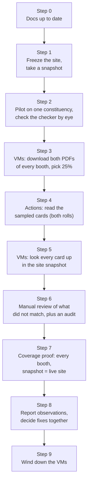

# Sample verification: 25% of every booth, from the PDF to the live site

## Goal

For **every one of the 60,923 booths** in all 224 constituencies, take at
least **25% of its voter cards**, read them afresh from ECI's own PDFs, and
check that the **live site** gives the right answer for each one: right
constituency, right booth, right serial, right deleted / not-deleted status.
Record every difference as an *observation*. **Nothing is fixed during the
run**: once the whole state is covered, the observations are reviewed and
acted on together.

This is a check of the finished product, end to end. It does not reuse any
reading the site was built from: the PDFs are downloaded again, read again,
and compared with what a visitor's browser would get.

## The plan at a glance

Everything runs in the cloud (the four free VMs and GitHub Actions). A
person's PC is needed only to look at review sheets.

## Step 1 — Freeze the site and take a snapshot

* The site must not change while it is being checked. No fixes are applied
  and no publish runs until step 7 (`publish.yml` runs only on a manual
  dispatch or a push to `site/` or `scripts/ci/build.mjs`; neither happens).
* `scripts/home/sv_snapshot.py` downloads all 65,536 data files
  (`data/roll/<ab>/<cd>.bin`) **from the live site**, the same URLs a
  visitor's browser uses, plus `data/manifest.json`. It stores them as
  `site-snapshot.tar` on the private results release with the SHA-256 of
  every file and the build time (`builtAt`).
* Looking a card up in the snapshot is byte-for-byte what the browser does
  (`site/app.js`: SHA-256 of the EPIC, bucket by the first two bytes, the
  next four bytes searched in it).

## Step 2 — Pilot on one constituency; check the checker

Before the state-wide run, one small constituency goes through every step,
and the checker itself is checked:

* 30 cards the checker calls "match" and every card it calls "no match" are
  looked at by eye on the PDF images.
* 20 of them are also searched on the real site in a browser; the answer
  shown must be what the snapshot lookup said.
* Timing and sizes are measured to confirm the estimates below.

## Step 3 — Download and pick the sample (VMs)

`scripts/home/sv_pilot.py --vm K` (systemd `sv-pilot@K`). VM K takes every
4th constituency, so the four VMs share the state evenly. For each booth:

1. Download the **Kannada** and the **English** PDF from ECI (fresh copies).
2. Cut every page into cards and count the cards on each page.
3. **Pick the sample.** Shuffle the booth's card pages with a fixed seed
   (`sv25-<ac>-<part>`, so a re-run picks the same pages) and take pages
   until at least 25% of the booth's cards are covered. Whole pages are
   taken, not single cards, because a page-level fault (a card skipped,
   serials shifted by one) shows across a whole page.
4. Cut the same pages of the English PDF.
5. Keep only the cut-out EPIC and serial boxes; the PDFs are deleted.

Each constituency's crops go up as one file `sv-<ac>.tar` to the private
release `crops-S10-2026-FR-sv`, with a booth list: pages, cards, sampled
pages, sampled cards. A booth whose PDF cannot be downloaded after 4 tries
is listed as *not covered*, and retried at the end.

## Step 4 — Read the sampled cards (GitHub Actions)

`sample-verify.yml`, one job per constituency, started by the VM once its
file is up. It reads every sampled card in **both** rolls with the same four
readers as the site, independently of anything read before: EPIC, serial,
and the deletion mark beside the serial. Output: `svread-<ac>.json.gz` on
the private results release `crops-S10-2026-FR-svr`.

## Step 5 — Look every card up on the site (VMs)

`scripts/home/sv_compare.py` takes each sampled card and decides what the
PDF says:

| Fresh reading | Treated as |
|---|---|
| Kannada and English agree on the EPIC | **settled** |
| Only one roll could be read | **one roll** |
| The two rolls disagree | **conflict** (both candidates are looked up) |
| Neither could be read | **unread** |

Then it looks the EPIC up in the snapshot, and also looks the other way: what
does the site have at this constituency, booth and serial?

| Result | Meaning |
|---|---|
| `ok` | Found at this AC, booth and serial, deleted status right |
| `ok-approx` | Right booth; the site marks the serial "~" and it is off |
| `serial` | Right booth, wrong serial, and not marked "~" |
| `deleted` | Right place, but deleted on one side and not the other |
| `wrong-place` | Found, but in another booth or constituency |
| `wrong-epic` | Not found, and the site has a *different* EPIC at this place |
| `missing` | Not found, and nothing at this place on the site |
| `extra` | Also found somewhere else (may be a real duplicate) |
| `page` | The site's cards for the page's serial range differ in number from the page |

Output: `svres-<ac>.json.gz` (private), and one public line per
constituency in `docs/proof/sample-verification.md` (counts only).

## Step 6 — Manual review

Machines find the candidates; a person decides. Review sheets show, for each
card, the **whole card** from the Kannada and English PDFs side by side, the
fresh readings and what the site says. Each card gets one verdict:
*site right*, *site wrong*, *reader wrong*, or *unclear*.

| Tier | What | How much is reviewed |
|---|---|---|
| A | Every non-`ok` result where the two rolls agree (settled) | **All** |
| B | Conflicts and one-roll cards where the site disagrees with a reading | **All** if under 20,000 state-wide, else 10 per constituency |
| C | Random `ok` cards: is "ok" really ok? | 5 per constituency (1,120) |
| D | Random cards searched **on the real site** in a headless browser on a VM | 5 per constituency (1,120) |

Verdicts are stored privately as `observations-<ac>.json` (they hold EPICs).
Constituencies are reviewed in order as their results arrive, so the review
runs alongside steps 3–5.

## Step 7 — Proof that everything is covered

The run is complete only when all of these hold:

* Every booth of every constituency is in a booth list (60,923), with
  sampled cards ≥ 25% of its cards, or is on the *not covered* list with the
  reason (and that list has been retried).
* Every constituency has a results file and a reviewed observations file.
* The live site is still the snapshot: all 65,536 files are downloaded again
  and their SHA-256 match the snapshot's.
* `docs/proof/sample-verification.md` lists every constituency: booths,
  cards checked, % `ok`, and the count of each result type.

## Step 8 — Observations and decisions

A report groups the observations by cause (as in the earlier gap work: a
skipped card, a misread serial, a heading taken for a deletion mark, …), with
counts per constituency and a few redacted examples. Fixes are decided
together afterwards and applied with the existing tools (`reverify_live.py`),
then the affected booths are re-checked.

## Step 9 — Wind down

Stop the `sv-pilot@K` services, delete the transit file `sv-<ac>.tar`s, keep
the results release. Stop the VMs only on the owner's word (see
[vm-process.md](vm-process.md): restarting a free VM can be refused for a
while).

## Making it fool-proof

| Risk | Guard |
|---|---|
| A session ends, a PC sleeps | Nothing runs on a PC. Services on the VMs restart by themselves; progress is the set of files on the releases, so a restart carries on where it stopped |
| A booth is skipped silently | Coverage is counted from the booth lists against the 60,923 booths, not from logs |
| The sample changes on a re-run | Fixed seeds per booth |
| The site changes during the run | Frozen; snapshot with SHA-256 of every file; compared again at the end |
| The checker is wrong | Step 2 by eye before the run; tier C and D audits during it |
| Real EPICs leak | All card-level files on private draft releases; only counts in git |
| A VM runs out of memory | One booth at a time; PDFs deleted after cutting |
| GitHub limits (1,000 files per release, 5,000 API calls/hour, 20 parallel jobs) | One file per constituency per stage, two releases; one release listing per poll; at most 3 jobs per VM in flight |
| Cost | Only the four Always Free VMs; Actions is free for public repos; downloads into OCI are free |

## Size and time (estimates, confirmed in step 2)

| | |
|---|---|
| PDFs downloaded | 60,923 × 2 ≈ 1.6 TB (inbound, free) |
| Cards checked | ≈ 1.1 crore (25% of 4.56 crore), in both rolls |
| Step 3 on 4 VMs | ≈ 12 hours (cutting is the slow part, ~2.7 s a booth) |
| Step 4 on Actions | ≈ 15 min per constituency, 20 at a time |
| Step 6 | depends on the number of observations |
