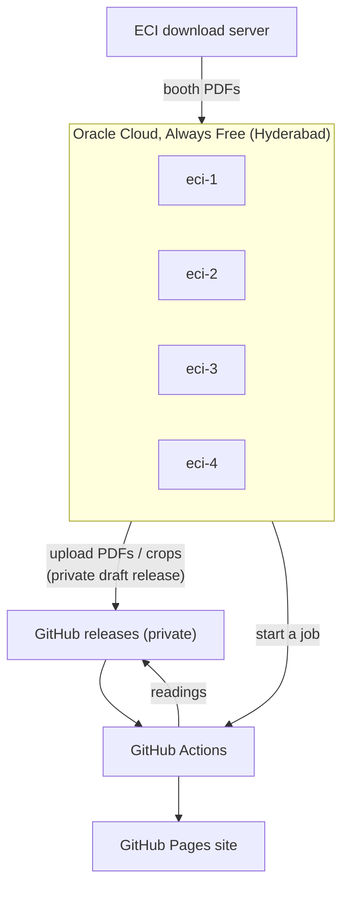

# The cloud VMs: why, how, and what runs on them

## Why VMs at all

* ECI's download server answers every GitHub Actions machine with `406
  Not Acceptable` (tested on Ubuntu, ARM, Windows and macOS runners). So
  GitHub can read and publish, but it cannot download.
* A home internet line downloads ~4 MB/s; the whole state (60,923 booths ×
  two languages, ~8–13 MB each) would take days and keep a PC on.
* An Oracle Cloud VM in Hyderabad downloads at ~35 MB/s, runs day and night,
  and four of them are free forever.

So the VMs **download and coordinate**; GitHub Actions does the heavy
reading (it has far more CPU, free for public repos).

## What we have (and why it costs nothing)

| | Per VM | All four | Always Free limit |
|---|---|---|---|
| Shape | VM.Standard.A1.Flex (Ampere, ARM) | | A1 only |
| CPU | 1 OCPU | 4 OCPU | 4 OCPU |
| Memory | 6 GB | 24 GB | 24 GB |
| Disk (boot volume) | 47 GB | 188 GB | 200 GB |
| OS | Ubuntu 24.04 (aarch64) | | |
| Network out | | ~0.9 TB used in Oct | 10 TB / month |

The four VMs use **exactly** the Always Free allowance. The account is a paid
(upgraded) account, so **a fifth VM, a bigger shape, or extra disk would be
billed**. Oct 2026 cost: ₹0. Nothing else (no load balancer, no object
storage, no extra volumes) exists in the account.

| Name | Main job |
|---|---|
| eci-1 | Kannada download autopilot (now disabled), English cross-check share 1 |
| eci-2 | English cross-check share 2, manual-review tools, applying fixes |
| eci-3 | English cross-check share 3 |
| eci-4 | English cross-check share 4 |

Login: `ssh -i ~/.ssh/oci_eci ubuntu@<ip>` (the IPs are kept outside git, in `cache/oci/ips.txt`).

## How the VMs were created

Free Ampere capacity in Hyderabad is often "out of host capacity", so a small
script (kept outside git, it holds account IDs) asked OCI again every few
minutes until four VMs existed:

    oci compute instance launch --shape VM.Standard.A1.Flex \
        --shape-config '{"ocpus":1,"memoryInGBs":6}' \
        --image-id <Ubuntu 24.04 aarch64> --subnet-id <public subnet> \
        --assign-public-ip true --ssh-authorized-keys-file ~/.ssh/oci_eci.pub \
        --display-name eci-K

It took about one hour of retries (27–28 Oct 2026).

## How each VM is set up (one time)

    sudo apt-get update
    sudo apt-get install -y git curl gh python3-venv tesseract-ocr tesseract-ocr-eng
    python3 -m venv ~/venv
    git clone https://github.com/gouthamganeshm/Karnataka_Final_Roll_2026 ~/verify
    ~/venv/bin/pip install -r ~/verify/scripts/ocr/requirements.txt
    echo "<GitHub token>" > ~/.gh_token && chmod 600 ~/.gh_token

* The token is the owner's personal token (5,000 GitHub API calls an hour,
  shared by all four VMs). It lets the VM read and write the **private draft
  releases** and start workflows.
* Always use `~/venv/bin/python`; the system `python3` has no numpy.
* `~/roll` is a second clone used by the download autopilot; `~/verify` is
  used by everything since.

## What runs on them

Each long job is a **systemd service**, so it restarts by itself after a crash
or a reboot, and pulls the latest code from GitHub before every start.

| Service | Script | What it does |
|---|---|---|
| `roll-autopilot` (eci-1, now disabled) | `scripts/home/autopilot.py` | Downloaded Kannada PDFs per the fixed plan `reference/vm-plan.json` (whole districts, no constituency on two VMs), uploaded them, started OCR on Actions, retried failures |
| `eng-pilot@K` (eci-K) | `scripts/home/eng_pilot.py --vm K` | English cross-check: download the English PDFs of every 4th constituency, have Actions read them, compare every card, apply the result once a person has decided the unsure ones |

Install a service (example: English pilot on VM 2):

    sudo cp ~/verify/scripts/home/eng-pilot@.service /etc/systemd/system/
    sudo systemctl daemon-reload
    sudo systemctl enable --now eng-pilot@2

Watch it: `journalctl -u eng-pilot@2 -f`. Stop it: `sudo systemctl disable --now eng-pilot@2`.

One-off jobs (fixes, sample checks) run under `nohup ... &` with a log file
in `~/verify/cache/`.

## Where the data goes

All on **draft** releases of this repo. A draft release is visible only to
the repo owner and the repo's own workflows; nothing on it is public.

| Release | Holds |
|---|---|
| `crops-S10-2026-FR` | The live files the site is built from: `live-rows-<ac>.jsonl.gz`, `live-verify-<ac>.json`, summaries |
| `crops-S10-2026-FR-work` | Files in transit: PDFs a VM uploaded for Actions, shard results (deleted after use) |
| `crops-S10-2026-FR-crops` | Every constituency's card crops, kept for re-checks |
| `crops-S10-2026-FR-eng` | English roll readings, cross-check ledgers, review sheets, manual decisions |

A GitHub release holds at most 1,000 files, which is why the work is spread
over several releases.

## Health checks

    # on each VM
    uptime; free -m; df -h /
    systemctl is-active eng-pilot@K
    ps -eo pid,etime,cmd | grep python

    # from anywhere: workflow runs and the site
    gh run list -R gouthamganeshm/Karnataka_Final_Roll_2026 -L 10
    curl -s https://gouthamganeshm.github.io/Karnataka_Final_Roll_2026/data/manifest.json | head -c 300

Lessons learned:

* `pkill -f <name>` over ssh also matches the ssh command itself and hangs;
  find the PID with `ps` and kill that.
* One VM has 6 GB; holding a whole constituency's PDFs in memory froze one
  once. Work one booth at a time.
* All four VMs share one 5,000/hour GitHub API allowance; tools list a
  release once per run, not once per file.

## Stopping and cleaning up

When nothing is running:

    sudo systemctl disable --now eng-pilot@K roll-autopilot   # on each VM
    oci compute instance action --action STOP --instance-id <id>   # from a PC

A stopped Always Free VM costs nothing. Starting it again can fail with "out
of host capacity" for a while, so stop them only when no more work is
planned. Terminating them deletes the disks too.
